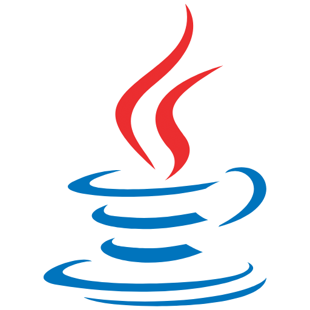

# Master Java Course by Andrés Guzman

## Something History

1. Developed by Sun Mycrosystems in the year 1995
2. Initially is started to developed in 1991 for smart cards and synthesizers of TV
3. Integrated by a team of 13 persons with James Gosling as leader
4. Based in C++
5. Initially called Oak but finally is renamed to Java
6. Launched publicly and oficial in 1996 with web support for the browser HotJava
7. Later in 1998 appears the first versions of Java EE (J2EE 1.0)

## Independent of the platform

The idea of Gosling was what the language Java it would be cross-platform his promise is:

> Write once, run anywhere!

an independent language of the operative system with an environment of execution called JVM (Java Virtual Machine)

## The Bytecode

All code Java is compiled to intermediate language, this is not 100% binary, this just in the middle of the machine and
source code and is called bytecode

the process is simple

1. We have a source code in java (.java)
2. This pass through the Java Compiler (javac)
3. this is transformed to bytecode (.class)
4. when the JVM act above the bytecode this transform the code for the OS
5. in time of execution interpret the bytecode in binary code or the machine language (0 and 1)

## Characteristics

1. A lot of type applications (console, desktop, web, distributed etc.)
2. Cross-platform
3. Oriented Object Programming Language
4. Garbage collector
5. Polymorphism
6. Modularity
7. Principle of concealment
8. Typed language